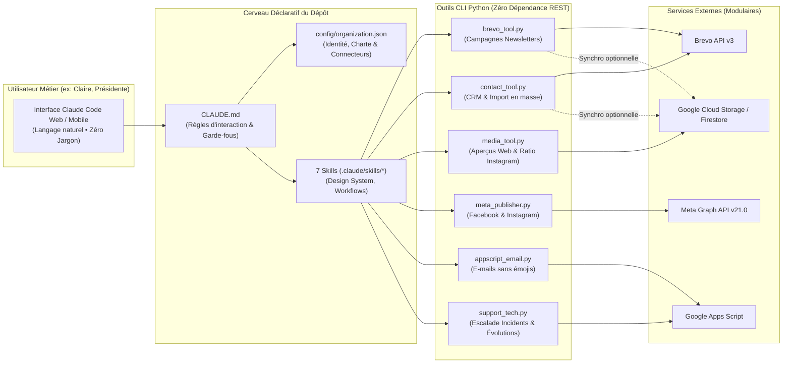

# Agent de Communication Métier avec Claude Code

[](https://www.python.org/)
[](#sous-le-capot--retour-dexpérience-dingénierie)
[](https://docs.anthropic.com/en/docs/agents-and-tools/claude-code/overview)
[](LICENSE)

> **Et si votre prochain SaaS interne n'avait besoin d'aucune interface frontend ?**  
> Ce dépôt est un **template d'architecture prêt à l'emploi** qui détourne **Claude Code (Web ou CLI)** pour en faire un **assistant de communication « Zéro Jargon »** destiné à un utilisateur métier non-technique (président·e d'association, responsable communication de PME, collectivité).

---

## Pourquoi cette approche ?

Construire un back-office sur mesure combinant éditeur de newsletters, générateur d'affiches A4, gestionnaire CRM, publication multi-réseaux (Facebook / Instagram) et envoi d'e-mails demande habituellement des semaines de développement frontend, d'authentification et de maintenance.

En combinant **Claude Code Web** (connecté à un dépôt GitHub) avec :
1. Un fichier d'instructions système strictes ([`CLAUDE.md`](CLAUDE.md)) qui interdit tout jargon informatique,
2. Des **Skills modulaires** ([`.claude/skills/`](.claude/skills/)) qui encadrent chaque flux de travail et la charte graphique,
3. Des **outils CLI Python sans dépendances tierces** ([`tools/`](tools/)) qui dialoguent directement en HTTPS/REST avec vos API,

vous offrez en quelques minutes à un utilisateur non-technique un **cockpit conversationnel autonome**, tout en gardant la traçabilité Git et une boucle de support humain-dans-la-boucle.

---

## Architecture Globale



---

## Fonctionnalités Clés

- **Génération & Envoi de Newsletters (Brevo)** : Rédaction à partir d'un gabarit HTML éditorial ([`templates/template_newsletter.html`](templates/template_newsletter.html)), génération d'un lien d'aperçu web, création du brouillon Brevo, envoi de tir de test et garde-fou de confirmation avant l'envoi final.
- **CRM & Import de Contacts en Masse** : Recherche multi-critères avec pagination complète (`limit=500`), enrichissement optionnel depuis Firestore (numéros de mobile, rôles) et import de listes entières en un seul appel API (`bulk-add --json`).
- **Publication Facebook & Instagram Clé en Main** : Conversion automatique à la volée des images WebP/PNG ou des affiches verticales A4 en fichiers `.jpg` respectant les ratios stricts d'Instagram Graph API (`4:5` à `1.91:1`) avec ajout de marges aux couleurs de la charte graphique.
- **Application Automatique de la Charte Éditoriale** : Nettoyage automatique à la volée des émojis dans les e-mails et newsletters si `allow_emojis_in_emails` est désactivé dans `config/organization.json`.
- **Escalade Humain-dans-la-Boucle (`support_tech.py`)** : En cas d'erreur bloquante d'une API tierce ou si l'utilisateur métier exprime un besoin d'évolution pertinent, Claude lui propose de prévenir le référent technique par e-mail (protégé par le flag obligatoire `--confirm`).
- **Mode `--dry-run` Intégral** : Toutes les commandes fonctionnent immédiatement après un `git clone`, sans aucune clé API configurée.

---

## Sous le capot : Retour d'expérience d'ingénierie

Le déploiement en conditions réelles d'un tel agent sur les **machines virtuelles éphémères de Claude Code Web** a mis en lumière plusieurs contraintes d'infrastructure résolues nativement dans ce dépôt :

### 1. Authentification Google Cloud 100 % Python standard + OpenSSL (Zéro `pip install`)
Les conteneurs éphémères de Claude Code Web ne pré-installent ni `google-auth`, ni `google-cloud-storage`, ni `google-cloud-firestore`. Par ailleurs, ils injectent parfois une variable d'environnement `CLOUDSDK_AUTH_ACCESS_TOKEN` expirée qui fait échouer la CLI `gcloud` (`HTTPError 401: Invalid Credentials`).
- **Solution implémentée dans [`tools/config.py`](tools/config.py)** : Suppression proactive de `CLOUDSDK_AUTH_ACCESS_TOKEN` au démarrage, génération et signature du jeton JWT `RS256` directement via le binaire système `openssl dgst -sha256 -sign`, puis appels directs aux API REST JSON de Google Cloud Storage et Cloud Firestore via `urllib.request`.

### 2. Gestion des plages d'IP sortantes des VM Claude Code (Anthropic CIDR)
L'adresse IP publique d'une session Claude Code Web change d'une exécution à l'autre. Si votre fournisseur d'API (comme **Brevo** dans *Sécurité > Adresses IP autorisées*) filtre les IP entrantes, les appels échoueront en `401 Unauthorized`.
- **Solution** : Autorisez le bloc CIDR sortant d'Anthropic **`160.79.104.0/21`** (`160.79.104.0` – `160.79.111.255`) dans votre pare-feu d'API ou désactivez le filtrage par IP unitaire.

### 3. Protection anti-fuite de secrets sur Git (`tools/git_sync.py`)
Les clés API résident exclusivement dans `.env` (ou dans les variables d'environnement du projet Claude Code Web) et `service_account.json`. En complément du `.gitignore`, le script [`tools/git_sync.py`](tools/git_sync.py) exécute systématiquement un `git reset HEAD .env service_account.json` avant chaque commit automatique effectué par l'agent.

---

## Démarrage Rapide (Test en 2 minutes sans clés API)

### 1. Cloner le dépôt
```bash
git clone https://github.com/jeremy-colard-dev/agent-communication-claude.git
cd agent-communication-claude
```

### 2. Vérifier le diagnostic de configuration
```bash
python tools/config.py status
```

### 3. Tester tous les outils en mode simulation (`--dry-run`)
Aucune clé API n'est nécessaire pour tester le comportement de l'agent :

```bash
# Générer un aperçu local de la newsletter d'exemple ("Les Ateliers du Parc")
python tools/media_tool.py preview newsletters/exemple_newsletter_octobre.html --name test_octobre --dry-run

# Simuler la création d'une campagne Brevo
python tools/brevo_tool.py create \
  --name "Newsletter Octobre 2026" \
  --subject "Les Ateliers du Parc — L'automne des savoir-faire partagés" \
  --html-file newsletters/exemple_newsletter_octobre.html \
  --dry-run

# Rechercher un contact dans le CRM simulé
python tools/contact_tool.py search "Claire" --dry-run

# Simuler une publication simultanée sur Facebook et Instagram
python tools/meta_publisher.py --platform both --message "Portes ouvertes ce samedi !" --image-url "https://exemple.org/photo.jpg" --dry-run

# Simuler l'envoi d'un ticket de support technique (avec confirmation utilisateur)
python tools/support_tech.py incident \
  --action "Création du brouillon de newsletter" \
  --tool "tools/brevo_tool.py" \
  --details "Exemple de rapport technique envoyé au référent" \
  --confirm --dry-run
```

---

## Adapter ce template à votre organisation en 3 étapes

1. **Personnalisez l'identité et la charte** dans [`config/organization.json`](config/organization.json) :
   - Remplacez l'exemple fictif (*Les Ateliers du Parc* / *Claire Martin*) par le nom de votre structure, le prénom de votre utilisateur métier, l'adresse e-mail du référent technique et vos couleurs hexadécimales.
2. **Configurez vos secrets** :
   - En local : copiez `.env.example` vers `.env` (`cp .env.example .env`) et renseignez uniquement les connecteurs que vous utilisez.
   - Sur **Claude Code Web** : déclarez vos variables (`BREVO_API_KEY`, `META_PAGE_ACCESS_TOKEN`, etc.) directement dans les variables d'environnement de votre espace Claude Code connecté à votre dépôt privé.
3. **Adaptez les gabarits HTML** dans [`templates/`](templates/) :
   - [`templates/template_newsletter.html`](templates/template_newsletter.html) : votre gabarit de lettre d'information mensuelle.
   - [`templates/template_affiche_a4.html`](templates/template_affiche_a4.html) : votre gabarit d'affiche événementielle A4.

---

## Structure du Projet

```text
agent-communication-claude/
├── CLAUDE.md                        # Prompt système principal lu par Claude Code
├── .env.example                     # Modèle des variables d'environnement (sans aucun secret)
├── service_account.example.json     # Modèle de compte de service GCP (optionnel)
├── config/
│   └── organization.json            # Identité de l'organisation, charte graphique et connecteurs
├── templates/
│   ├── template_newsletter.html     # Gabarit HTML éditorial pour les newsletters
│   └── template_affiche_a4.html     # Gabarit HTML pour les affiches A4 et réseaux sociaux
├── newsletters/
│   └── exemple_newsletter_octobre.html # Exemple complet prêt à prévisualiser
├── skills/ & .claude/skills/        # 7 Skills métiers guidant Claude étape par étape
│   ├── design-system/
│   ├── newsletter-brevo/
│   ├── contact-manager/
│   ├── media-manager/
│   ├── social-publisher/
│   ├── email-sender/
│   └── support-tech/
└── tools/                           # Outils CLI Python (zéro dépendance REST + mode --dry-run)
    ├── config.py                    # Chargeur .env / organization.json & Auth GCP OpenSSL
    ├── brevo_tool.py                # Gestion des campagnes Brevo & synchro Firestore optionnelle
    ├── contact_tool.py              # CRM Brevo (recherche paginée, ajout, import bulk-add)
    ├── media_tool.py                # Aperçus web, upload GCS et cadrage ratio Instagram
    ├── meta_publisher.py            # Publication Facebook & Instagram via Meta Graph API
    ├── appscript_email.py           # Envoi d'e-mails transactionnels sans émojis
    ├── support_tech.py              # Signalement d'incidents & évolutions avec garde-fou --confirm
    └── git_sync.py                  # Sauvegarde Git avec protection anti-commit de .env
```

---

## Auteur & Licence

Conçu et développé par **Jérémy Colard** — [@jeremy-colard-dev](https://github.com/jeremy-colard-dev).

Distribué sous licence [MIT](LICENSE). Vous êtes libre de cloner, modifier et déployer cette architecture pour vos associations, vos clients ou vos équipes métiers.
