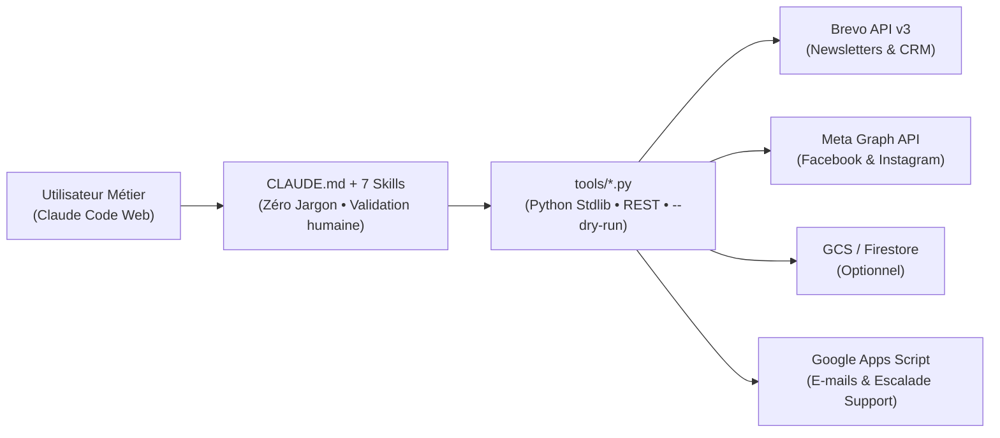

# agent-communication-claude

[](https://www.python.org/)
[](#notes-dingénierie-vm-claude-code-web)
[](LICENSE)

Détournement pragmatique de **Claude Code (Web / CLI)** pour offrir un poste de pilotage de communication complet (Newsletters Brevo, CRM, Facebook, Instagram, Affiches A4, E-mails) à un utilisateur métier non-technique — sans coder la moindre ligne de frontend.

---

## 1. Enjeu — Le Pourquoi 🎯

Dans une association ou une petite structure, la personne qui porte la communication (président·e, bénévole, office manager) passe ses soirées à se battre contre 5 onglets ouverts : Brevo, Canva, Meta Business Suite, un vieux fichier Excel de contacts et sa boîte mail.

Construire un back-office sur mesure coûte trop cher à produire, et personne n'a envie de maintenir un énième dashboard React le dimanche soir.  
L'idée est donc d'aller au plus court : **permettre à un profil non-technique de piloter toute sa communication en français courant**, depuis son navigateur ou son téléphone, sans jamais voir un terminal, un `git push` ou une erreur HTTP. *(Promis, aucun président d'association n'a été forcé d'apprendre Vim pendant la conception de ce projet).*

---

## 2. Fait — L'Architecture ⚙️

Plutôt que de créer une interface web, on branche **Claude Code Web** sur un dépôt Git structuré autour de trois briques :

1. **Un cadre système strict ([`CLAUDE.md`](CLAUDE.md) & [`config/organization.json`](config/organization.json))** : interdit tout jargon technique, impose la charte graphique et exige une validation humaine avant chaque envoi réel.
2. **7 Skills métiers ([`.claude/skills/`](.claude/skills/))** : cadrent l'agent pas à pas (aperçu web obligatoire avant envoi de newsletter, recadrage d'image avant publication Instagram, escalade au référent technique en cas de pépin).
3. **8 scripts Python autonomes ([`tools/`](tools/))** : écrits uniquement avec la bibliothèque standard (`urllib.request`) pour tourner à froid sur les VM éphémères de Claude Code, avec un mode `--dry-run` sur chaque commande.



---

## 3. Action — Tester et Déployer 🚀

### Tester en local (2 minutes, zéro clé API)

Toutes les commandes intègrent un mode `--dry-run` basé sur une association fictive pré-configurée (*Les Ateliers du Parc*).

```bash
git clone https://github.com/jeremy-colard-dev/agent-communication-claude.git
cd agent-communication-claude

# 1. État des connecteurs
python tools/config.py status

# 2. Aperçu local d'une newsletter HTML
python tools/media_tool.py preview newsletters/exemple_newsletter_octobre.html --name test_octobre --dry-run

# 3. Simulation d'un brouillon de campagne Brevo (avec nettoyage auto des émojis)
python tools/brevo_tool.py create \
  --name "Newsletter Octobre 2026" \
  --subject "Les Ateliers du Parc — Lettre d'octobre" \
  --html-file newsletters/exemple_newsletter_octobre.html \
  --dry-run

# 4. Recherche CRM et publication Facebook / Instagram simulées
python tools/contact_tool.py search "Claire" --dry-run
python tools/meta_publisher.py --platform both --message "Portes ouvertes samedi !" --image-url "https://exemple.org/img.jpg" --dry-run
```

### Adapter à votre structure

1. **Identité & Charte** : modifiez [`config/organization.json`](config/organization.json) (nom, utilisateur métier, couleurs, référent technique, connecteurs actifs).
2. **Gabarits HTML** : ajustez [`templates/template_newsletter.html`](templates/template_newsletter.html) et [`templates/template_affiche_a4.html`](templates/template_affiche_a4.html).
3. **Secrets** : copiez [`.env.example`](.env.example) vers `.env` en local, ou déclarez directement vos clés dans les variables d'environnement de **Claude Code Web**.

---

## Notes d'ingénierie (VM Claude Code Web) 🔧

Quatre pièges rencontrés en production réelle (et évités ici pour vous épargner quelques cheveux blancs) :

- **Zéro dépendance `pip` pour Google Cloud ([`tools/config.py`](tools/config.py))** : les conteneurs éphémères de Claude Code Web n'embarquent pas `google-auth` et injectent parfois une variable `CLOUDSDK_AUTH_ACCESS_TOKEN` expirée qui met `gcloud` en échec. Le script purge cette variable au démarrage, signe le JWT `RS256` via le binaire système `openssl`, et attaque directement les endpoints REST de GCS et Firestore.
- **Filtrage d'IP sortantes (Anthropic CIDR)** : l'IP publique des VM Claude Code change à chaque session. Si Brevo bloque les appels API en `401 Unauthorized` (*Unrecognised IP address*), autorisez la plage CIDR d'Anthropic **`160.79.104.0/21`** dans *Brevo > Sécurité > Adresses IP autorisées*.
- **Normalisation Instagram Graph API ([`tools/media_tool.py`](tools/media_tool.py))** : l'API Instagram est allergique aux PNG/WebP et aux formats A4 (`1:1.414`). La commande `social-jpg` convertit tout visuel en JPEG et ajoute automatiquement des marges latérales aux couleurs de la charte pour respecter le ratio `4:5` (`0.8`).
- **Support humain-dans-la-boucle ([`tools/support_tech.py`](tools/support_tech.py))** : si l'utilisateur métier rencontre un blocage API ou demande une évolution non prévue, l'agent lui propose d'envoyer un rapport technique propre par e-mail au développeur référent (bloqué tant que le flag `--confirm` n'est pas validé par l'utilisateur).

---

## Structure du dépôt

```text
├── CLAUDE.md                        # Instructions système (rôle, garde-fous, zéro jargon)
├── config/organization.json         # Configuration déclarative de la structure et de la charte
├── .env.example                     # Variables d'environnement (API Brevo, Meta, GCP, Apps Script)
├── templates/                       # Gabarits HTML (Newsletter & Affiche A4)
├── newsletters/                     # Exemple de newsletter prête à prévisualiser
├── .claude/skills/                  # 7 Skills métiers (design, brevo, crm, media, social, mail, support)
└── tools/                           # Scripts CLI Python (stdlib + mode --dry-run)
```

---

## Licence & Auteur

Distribué sous licence [MIT](LICENSE).

Jérémy Colard 🙂 — [@jeremy-colard-dev](https://github.com/jeremy-colard-dev)
